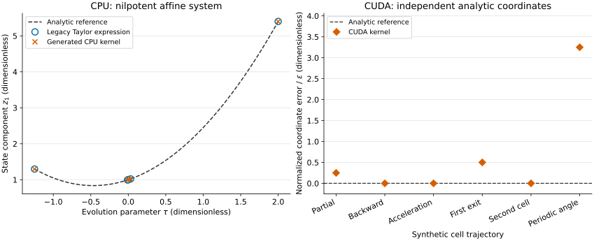

# Independent analytic cell oracles



The left panel compares a direct evaluation of the legacy Taylor expression
and the generated CPU kernel with the exact trajectory of the native
nilpotent affine-system test. Its first state component is
$z_1(\tau)=1+0.7\tau+0.75\tau^2$, where the evolution parameter $\tau$
and the state are dimensionless. The case is defined in the
[native CPU test](../../../SRC/TESTS/test_cell_generated_driver.f90). The circles and crosses are computed native
outputs; the dashed curve is the independent analytic expression. The CSV
contains all four state components; the figure selects the first.

The right panel shows actual CUDA coordinate errors against the analytic
values checked by the
[native device test](../../../SRC/TESTS/test_cuda_poly2.cu) for partial, backward, accelerated,
two-cell and periodic trajectories. All synthetic test coordinates are
dimensionless. The plotted error is
$|x-x_{\mathrm{ref}}|/[\epsilon\max(1,|x_{\mathrm{ref}}|)]$, where $x$ is the computed CUDA coordinate,
$x_{\mathrm{ref}}$ is the analytic coordinate and $\epsilon$ is double
precision machine epsilon. The first periodic-angle case is shown; the CSV
retains the other coordinate systems and the quantities exported from
numerical comparisons.

These are local arithmetic and cell-transition checks. They do not establish
real-equilibrium orbit agreement, long-time conservation or application speedup.
The plot uses the Okabe–Ito blue and vermilion palette, with marker shapes and
line styles that remain distinct without color.

To reproduce the CSV files and figure from this directory, use a GNU Fortran
compiler, a compatible CUDA toolkit with a visible GPU, Python, NumPy and
Matplotlib:

```sh
python export_trace.py --repo ../../..
gfortran -O3 -Jbuild ../../../SRC/generated/gorilla_cell_generated.f90 \
  build/cpu_trace.f90 -o build/cpu_trace
build/cpu_trace > cpu_trace.csv
nvcc -std=c++17 -O3 -arch=native -I ../../../SRC \
  ../../../SRC/gorilla_cuda.cu build/cuda_trace.cu -o build/cuda_trace
build/cuda_trace > cuda_trace.csv
python plot.py
```

The exporter adds CSV output to copies of the existing native test programs,
preserving their assertions. No benchmark timings or machine metadata are
included.
