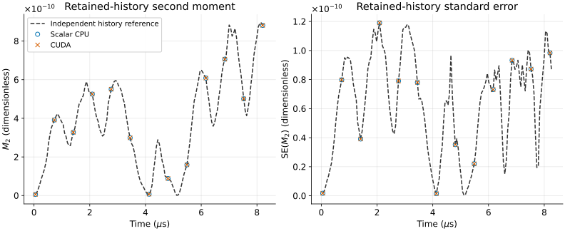

# Transport estimator with boundary losses



Scalar CPU and CUDA outputs are compared on the public VMEC regression fixture
in the [native transport test](https://github.com/itpplasma/GORILLA_APPLETS/blob/d43d2504ca96314df6e6c821c7098764889eae76/TESTS/test_mono_energetic_transport_slow.py#L299-L368).
The case uses sixteen synthetic 3-keV electron markers, normalized flux
coordinate $s=0.99999$, initial pitch one and a fixed seed. Nine markers leave
the mesh. Both tracers use the same generated-core build; scalar CPU does not
denote an older pre-generation executable.

For measurement time $t_k$, let $S_k$ contain the markers whose history retains
that measurement and let $N_k=|S_k|$. Let $s_i(t)$ be the normalized flux
coordinate of marker $i$ at time $t$, and define
$\Delta s_{i,k}=s_i(t_k)-s_i(0)$. The independently reconstructed second
moment $M_2$, fourth moment $M_4$ and standard error $\mathrm{SE}(M_2)$ are

$$
M_2(t_k)=\frac{1}{N_k}\sum_{i\in S_k}(\Delta s_{i,k})^2,
\qquad
M_4(t_k)=\frac{1}{N_k}\sum_{i\in S_k}(\Delta s_{i,k})^4,
\qquad
\mathrm{SE}(M_2)=\sqrt{\frac{\max(0,M_4-M_2^2)}{N_k}}.
$$

The dashed curves reconstruct these quantities from the CUDA marker histories.
Circles and crosses are the independently written scalar CPU and CUDA moment
files. The plotted second moment and its reported standard error are dimensionless
(squared normalized flux); time is shown in microseconds. Curves include every
retained measurement. Markers select every thirteenth measurement for
legibility; the CSV retains every value and its contributor count.

All reported moments and standard errors agree with the reconstruction within
the native test's componentwise tolerance
$|m-r|\leq\max(10^{-20},10^{-8}\max(|m|,|r|))$, where $m$ is the reported
quantity and $r$ is its reconstruction. The exporter also verifies matching loss
counts, marker identifiers, loss reasons and loss steps. These checks establish
agreement on this fixed fixture, rather than statistical convergence, physical
transport accuracy or application speedup.

To reproduce the figure, build the CUDA-enabled APPLETS revision linked above
with the core revision in its `GORILLA_REF`, install Python's NumPy,
Matplotlib and f90nml packages, and run from this directory:

```sh
python capture_outputs.py --applets /path/to/GORILLA_APPLETS \
  --core /path/to/GORILLA --binary /path/to/gorilla_applets_main.x \
  --work /path/to/new-transport-work
python export_transport.py --scalar /path/to/new-transport-work/scalar_boundary_loss \
  --cuda /path/to/new-transport-work --output transport.csv
python plot.py
```

The capture helper runs the existing native driver through its boundary-loss
assertions and stops before the rejection probes, which intentionally truncate
successful output files. It preserves all preceding assertions. The exporter
reads actual reported moments separately from the retained-history reference.
The figure uses the Okabe–Ito blue and vermilion palette, with marker shapes
and line styles that remain distinct without color.
